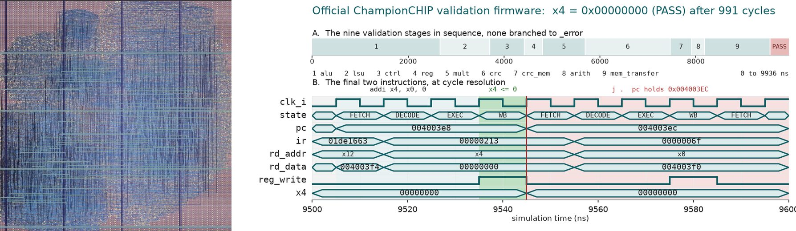
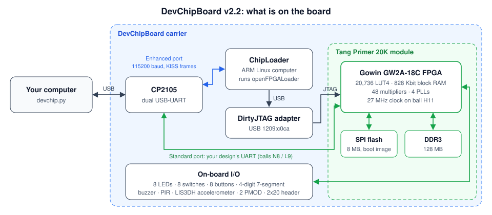
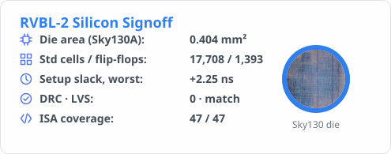
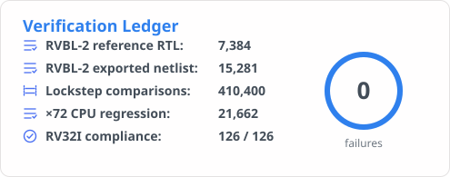

<!-- ═══════════════════════════════════════════════════════════ -->
<!--                       HERO BANNER                           -->
<!--   All visuals are self-hosted in assets/ (see scripts/).    -->
<!-- ═══════════════════════════════════════════════════════════ -->

<picture>
  <source media="(prefers-color-scheme: dark)" srcset="assets/typing-dark.svg">
  
</picture>

 

<picture>
  <source media="(prefers-color-scheme: dark)" srcset="assets/wave-top-dark.svg">
  
</picture>

  <strong>B.Eng (Hons) Electrical & Computer Systems Engineering</strong> &nbsp;|&nbsp; Minor in Semiconductors 
  <em>Monash University Malaysia</em>

<!-- Focus -->

  
  &nbsp;
  
  &nbsp;
  

<!-- Recognition -->

  
  &nbsp;
  

---

<!-- ═══════════════════════════════════════════════════════════ -->
<!--                       ABOUT ME                              -->
<!-- ═══════════════════════════════════════════════════════════ -->

## 🧬 About Me

I'm an **Electrical & Computer Systems Engineering** student at Monash University Malaysia, specialising in **digital hardware design** and **computer architecture**, alongside **machine learning** and **quantitative finance**, with a minor in **Semiconductors**.

I like owning the whole path of a chip: writing the RTL, proving it correct, getting it running on an FPGA, and taking it through to a signed-off layout. My most recent processor, **RVBL-2**, went from Verilog to a DRC- and LVS-clean SkyWater Sky130 layout and won **ChampionCHIP Malaysia 2026**.

- 🔭 &nbsp;Currently building an **FPGA emulator of memristor crossbars** for spiking neural networks (research)
- 🧠 &nbsp;Training a **graph neural network** to flag timing-critical paths before routing
- 📈 &nbsp;Working on **quantitative finance** projects (private)

---

<!-- ═══════════════════════════════════════════════════════════ -->
<!--                    ENGINEERING FOCUS                        -->
<!-- ═══════════════════════════════════════════════════════════ -->

## ⚡ Engineering Focus

| Domain | What I Do |
|:---|:---|
| **RTL & Digital Design** | Verilog RTL for multicycle processors: datapaths, FSM control units, load/store units and custom ISA extensions |
| **CPU Architecture** | RISC-V (RV32I + Zmmul + custom CRC instructions) and a custom 16-bit ISA, from instruction encoding to running firmware |
| **Physical Design** | RTL-to-GDSII with OpenLane on SkyWater Sky130: placement and routing, multi-corner STA, DRC/LVS signoff |
| **Verification** | Self-checking regressions, golden vectors, cycle-by-cycle lockstep equivalence, re-runs on exported netlists |
| **FPGA** | Intel MAX 10 with Quartus, Gowin GW2A with Yosys + nextpnr, including bring-up of an undocumented board |
| **Embedded Systems** | DMA-driven STM32 firmware in C, Raspberry Pi, Arduino, UART and SPI links |
| **ML & Quant** | Graph neural networks for timing prediction (PyTorch Geometric); quantitative finance |

---

<!-- ═══════════════════════════════════════════════════════════ -->
<!--                    TECHNICAL SKILLS                         -->
<!-- ═══════════════════════════════════════════════════════════ -->

## 🛠️ Technical Stack

<strong>🔷 Hardware & RTL Design (Core)</strong>

 

  
  
  
  
  
  
  

<strong>🧱 Physical Design & Open-Source EDA</strong>

 

  
  
  
  
  
  
  

<strong>💻 Embedded, Firmware & Systems</strong>

 

  
  
  
  
  
  

<strong>🤖 AI, ML & Scientific Computing</strong>

 

  
  
  
  
  
  

<strong>🌐 Languages & Tools</strong>

 

  
  
  
  
  
  
  

---

<!-- ═══════════════════════════════════════════════════════════ -->
<!--                   PROJECT SHOWCASE                          -->
<!-- ═══════════════════════════════════════════════════════════ -->

## 🧩 Project Showcase

### ⭐ Featured

<strong>🔬 RVBL-2: RISC-V Core, RTL to Signed-off GDSII &nbsp;|&nbsp; <em>Champion, ChampionCHIP Malaysia 2026</em></strong>

 

> A 32-bit RISC-V processor taken from Verilog to a clean SkyWater Sky130 layout, with mechanical proof that the layout is the design that was verified.

| | |
|:---|:---|
| **ISA** | RV32I + Zmmul + 3 custom CRC instructions: **47 / 47 implemented** |
| **Microarchitecture** | 6-state multicycle FSM, 3–5 cycles per instruction, 16 RTL modules |
| **Verification** | **7,384** checks across 15 self-checking testbenches, plus **15,281** re-run on the netlist the platform exported; official firmware **PASS** |
| **Equivalence** | **410,400** cycle-by-cycle lockstep comparisons against the reference RTL with **0 mismatches**, plus a netlist graph-isomorphism check |
| **Physical Design** | OpenLane on Sky130A · **0.404 mm²** die · 17,708 cells · setup slack **+2.25 ns** at the worst corner (33 ns clock) |
| **Signoff** | **0** Magic DRC · **0** KLayout DRC · **0** routing violations · LVS match |
| **Key Finding** | Heuristic antenna-diode insertion cost **19.5 %** of die area and left the same residual violations as targeted repair with 325 diodes. Disabling it shrank the die and recovered ~1.9 ns of setup slack |
| **Stack** | Verilog · Icarus Verilog · Yosys · OpenLane · OpenROAD · Magic · KLayout · Python |

  
   Left: final Sky130 layout &nbsp;·&nbsp; Right: official ChampionCHIP firmware passing (<code>x4 = 0x00000000</code> after 991 cycles)

  
  
  

---

<strong>🔧 DevChip Local: Open Toolchain for an Undocumented FPGA Board &nbsp;|&nbsp; <em>Solo Project</em></strong>

 

> The FPGA board I won at ChampionCHIP could only be programmed through a subscription cloud platform. I reverse-engineered how it is programmed and replaced the platform with open-source tools.

| | |
|:---|:---|
| **Hardware** | DevChipBoard v2.2 · Sipeed Tang Primer 20K · Gowin GW2A-LV18 (20,736 LUT4) |
| **Reverse Engineering** | Traced programming to an on-board ARM Linux "ChipLoader" speaking KISS-framed serial at 115,200 baud, which drives openFPGALoader through a DirtyJTAG adapter; mapped all **93** board pins |
| **Toolchain** | `devchip run` → Yosys → pin-safety check → nextpnr-himbaechel → gowin_pack → programmed over plain USB with an MD5 check |
| **Flash Backup** | A custom read-only FPGA design streams the 8 MB boot flash back at 921,600 baud in CRC-checked 64 KiB blocks, then verifies it with a second read |
| **Safety** | Refuses designs that would drive a board-driven pin, reuse a pin, target another FPGA, or release the JTAG pins |
| **Examples** | UART and SPI cores, an accelerometer bridge, a PLL generator, and a Whack-a-LED arcade game with its own testbench |
| **Stack** | Python · Verilog · Yosys · nextpnr · Apicula · openFPGALoader |

  

  
  

### 🗂️ More Projects

| Project | Context | |
|:---|:---|:---:|
| **⚙️ 16-bit ×72 Multicycle CPU**  Team lead & architect | Custom 8-instruction ISA on a single-bus datapath with one-hot 4-tick control; **21,662** self-checking tests, runs on a DE10-Lite | [Repo](https://github.com/Niccc8/16-bit-x72-multicycle-single-bus-processor) · [Live sim](https://niccc8.github.io/fpga-simulation-scaled-triangular-number-sequence/fpga_simulation.html) |
| **🧮 RV32I RISC-V Core**  Verilog · FPGA | Multicycle RV32I core written after studying PicoRV32, with its own assembler; **126 / 126** compliance tests, **117 MHz** on Intel MAX 10 | [Repo](https://github.com/Niccc8/rv321-risc-v-cpu-processor) |
| **🛡️ Sentinel: Zero-Trust IoT**  Champion, Track 3, IoT Hackathon 2026 · Team lead | Every sensor reading signed on-device (Ed25519, X25519 sessions); the gateway tells a compromised device apart from a compromised network | [Repo](https://github.com/Niccc8/sentinel-zero-trust-iot) |
| **🎙️ Audio Acquisition System**  Dual STM32 · DMA | 12-bit audio at 44 kHz across two STM32s over SPI and UART DMA, filtered and streamed to WAV by a Python CLI | [Repo](https://github.com/Niccc8/high-fidelity-audio-acquisition-system-ece2071) |
| **🧠 GNN Timing-Criticality Predictor**  AI for EDA · in progress | Heterogeneous graph attention network ranking timing endpoints in pre-routing netlists; results being validated | [Repo](https://github.com/Niccc8/gnn-static-timing-analysis-predictor) |
| **🌌 Memristor Emulation for SNNs**  Research · in progress | Verilog memristor model and a 64-column crossbar vector-matrix-multiply engine on Intel MAX 10 | Private |
| **🚦 Real-Time Traffic Control**  Team lead | Five FSM-driven subsystems built from discrete logic and analogue circuits, coordinated from Python | n/a |
| **💻 NovaCode**  Founder | EdTech platform matching students with programming tutors, with an in-browser IDE | n/a |

---

<!-- ═══════════════════════════════════════════════════════════ -->
<!--                     STATS                                   -->
<!-- ═══════════════════════════════════════════════════════════ -->

## 📊 Silicon & GitHub Stats

<picture>
  <source media="(prefers-color-scheme: dark)" srcset="assets/card-silicon-dark.svg">
  
</picture>
<picture>
  <source media="(prefers-color-scheme: dark)" srcset="assets/card-verification-dark.svg">
  
</picture>

<picture>
  <source media="(prefers-color-scheme: dark)" srcset="profile/stats-dark.svg">
  
</picture>
<picture>
  <source media="(prefers-color-scheme: dark)" srcset="profile/top-langs-dark.svg">
  
</picture>

<picture>
  <source media="(prefers-color-scheme: dark)" srcset="profile/streak-dark.svg">
  
</picture>

Hardware cards are built from the project repositories; GitHub cards regenerate daily in this repo via GitHub Actions.

---

<!-- ═══════════════════════════════════════════════════════════ -->
<!--                     CONNECT                                 -->
<!-- ═══════════════════════════════════════════════════════════ -->

## 🌐 Connect

&nbsp;

&nbsp;

---

<picture>
  <source media="(prefers-color-scheme: dark)" srcset="assets/wave-bottom-dark.svg">
  
</picture>

<i>"Trying to make a rock think"</i>

